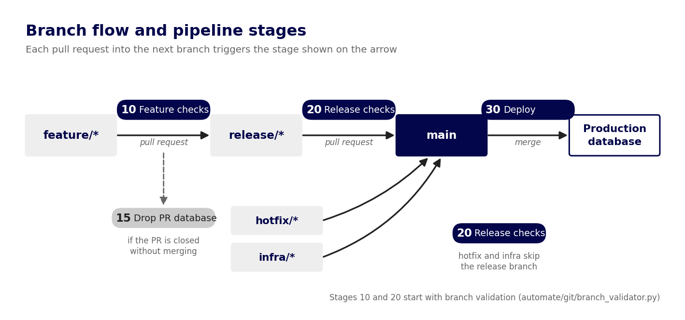

# CI/CD Pipelines

The workflows in `.github/workflows/` validate every change before it reaches production and then deploy it with zero downtime. This repository implements the full release flow (feature → release → `main`). This documentation explains what each stage does, step by step, and how to customize it, including [how to simplify it](ci_cd/simpler-flow.md) for teams that merge feature branches straight into `main`. Start with the stages below, then follow the [documentation map](#documentation-map).

For a higher-level overview of what these pipelines give you, see [CI/CD best practices](https://docs.datacoves.com/docs/best-practices/ci-cd) in the Datacoves docs.

## Numbered stages

Workflow files are prefixed with a number that tells you where in the delivery lifecycle they run. Gaps between numbers are intentional, so you can add your own stages without renaming existing files.

| Stage | Workflow | Runs when | Purpose |
|---|---|---|---|
| **10** | `10_feature_dbt_checks.yml`, `10_feature_airflow_checks.yml` | A pull request (PR) from a feature branch targets a release branch | Build and test the change in an isolated PR database, run governance checks, validate Airflow DAGs |
| **15** | `15_drop_feature_db.yml` | A PR into a release branch is closed | Drop the PR database when the PR was abandoned |
| **20** | `20_release_dbt_checks.yml` | A PR targets `main` (release, hotfix or infra branch) | Build the release in a QA database cloned from production |
| **30** | `30_deploy_changes_to_production.yml` | A commit lands on `main` | Blue/green deploy to production, clean up, publish docs and artifacts, tag the version |

Workflows that are specific to this demo, such as `12_feature_cartage_checks.yml` and `99_schedule_image_pandas.yml`, are not covered here.

## Flow at a glance

## Documentation map

| I want to... | Read |
|---|---|
| Understand which branches and merges are allowed | [Branching and validation](ci_cd/branching-and-validation.md) |
| See which database each stage uses | [Database lifecycle](ci_cd/database-lifecycle.md) |
| Set up variables, secrets and CI images | [Configuration](ci_cd/configuration.md) |
| Know what runs on a feature PR | [Stage 10: Feature checks](ci_cd/stage-10-feature-checks.md) |
| Rebuild incremental models from scratch | [Full refresh](ci_cd/full-refresh.md) |
| Know when PR databases are dropped | [Stage 15: Drop PR database](ci_cd/stage-15-drop-pr-database.md), [PR database cleanup](ci_cd/pr-database-cleanup.md) |
| Know what runs on a PR into `main` | [Stage 20: Release checks](ci_cd/stage-20-release-checks.md) |
| Know how production is deployed | [Stage 30: Deploy to production](ci_cd/stage-30-deploy-to-production.md) |
| Change prefixes, paths, images or add a stage | [Customize the pipelines](ci_cd/customization.md) |
| Merge feature branches straight into `main` | [Use a simpler flow](ci_cd/simpler-flow.md) |
| Add markers, stricter branch names or other extras | [Optional extensions](ci_cd/optional-extensions.md) |
